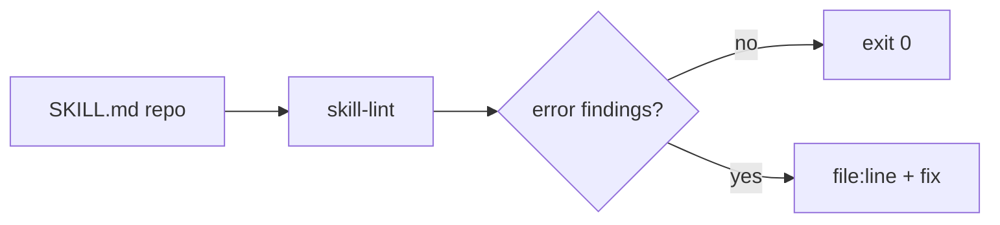

<div align="center">

<h1>skill-ci</h1>

<p><strong>Catch broken, bloated, and conflicting agent skills before they ship.</strong></p>

<p>Static lint and trigger evaluation for <code>SKILL.md</code> repositories.<br/>
Zero dependencies · no network · no LLM calls.</p>

<p>
<a href="https://github.com/zhengqiuyang/skill-ci/actions/workflows/skill-ci.yml"></a>
<a href="https://www.python.org/"></a>
<a href="LICENSE"></a>
</p>

<p><code>pip install .</code> &nbsp;or&nbsp; <code>bin/skill-lint examples/skills</code></p>

<p>
<a href="#quick-start">Quick start</a> ·
<a href="#rules">Rules</a> ·
<a href="#skill-test">skill-test</a> ·
<a href="#github-action">GitHub Action</a> ·
<a href="#limits">Limits</a>
</p>

</div>

<a id="quick-start"></a>
## Quick start

Run it on the bundled example — no install, no config:

```sh
bin/skill-lint examples/skills
```

Windows:

```bat
bin\skill-lint.cmd examples\skills
```

Expected: `Skills scanned: 1`, `0 error(s)`, exit code 0.

Point it at your own skill repository:

```sh
bin/skill-lint /path/to/your/skills
bin/skill-lint /path/to/your/skills --format json --out report.json
```

Exit codes: `0` = no error findings, `1` = at least one error finding,
`2` = usage/IO error.

> [!TIP]
> The `bin/` launchers need no `pip install`: they locate the repository,
> put `src/` on `PYTHONPATH`, and run from any working directory.
> `pip install .` also provides `skill-lint` and `skill-test` console scripts.

## Why skill-ci

- **Broken frontmatter breaks registration.** A missing `name` or an invalid
  name makes name-based tooling fall back to the directory name or skip the
  skill.
- **Oversized skills tax every turn.** A skill that loads 26k tokens into
  context is expensive even when it is the right skill.
- **Bad descriptions fail silently.** Generic or overlapping descriptions
  route prompts to the wrong skill, and nothing in a normal session tells you.

`skill-ci` turns those three failure modes into deterministic checks you can
run locally or in CI.

## How it works



`skill-test` is the second check: it indexes each skill's trigger metadata and
measures whether the right skill fires for a labeled prompt suite.

<a id="rules"></a>
## What `skill-lint` checks

22 deterministic rules in six groups:

| Group | Rules | Catches |
| --- | --- | --- |
| Frontmatter | FM001–FM008 | missing/unclosed frontmatter, missing `name`/`description`, invalid `name`, name/directory mismatch, unknown keys, raw nested metadata |
| Description quality | DQ001–DQ004 | too short, generic filler, missing “use when” guidance, description over 1024 chars |
| Token budget | TK001–TK002 | body over ~5k tokens (warning), over ~15k (error) |
| Duplicates / conflicts | DUP001–DUP003 | duplicate names, near-identical descriptions, overlapping trigger scope |
| Security | SEC001–SEC003 | destructive shell commands, credential-shaped strings, download-and-execute patterns |
| Structure | STRUCT001–STRUCT002 | no `SKILL.md`, unreadable file |

Every finding carries `rule_id`, `severity`, `file`, `line`, `message` and a
fix hint. Markdown groups findings by rule; JSON keeps every instance.

## `skill-lint` usage

```sh
bin/skill-lint <repo> [--format markdown|json] [--out FILE] [--all-instances]
```

| Flag | Effect |
| --- | --- |
| `--format json` | instance-level output for CI or dashboards |
| `--out FILE` | write the report to a file instead of stdout |
| `--all-instances` | expand the Markdown report to one row per finding |

Example:

```text
# skill-lint report

- Target: `examples/skills`
- Skills scanned: 1
- Findings: 0 error(s), 0 warning(s), 0 info
- Exit code: 0

## Skill inventory

| skill | name | body tokens (est.) | description chars |
| --- | --- | ---: | ---: |
| `example-skill/SKILL.md` | example-skill | 20 | 115 |

## Findings by rule

No findings. All checks passed.
```

<a id="skill-test"></a>
## `skill-test`: does the right skill trigger?

```sh
bin/skill-test <repo> --suite prompts.jsonl [--format markdown|json] [--out FILE] [--threshold 1.0]
```

`skill-test` indexes each skill's `name` + `description` + `when_to_use`, scores
every prompt with a stdlib Okapi BM25 index (plus a substring fallback), and
compares the top prediction with the expected skill. It reports:

- trigger precision and recall;
- TP / FP / FN / TN;
- every false positive and false negative with the exact terms that produced
  the score;
- per-skill expected-vs-predicted hit counts;
- the context cost of the trigger metadata.

No LLM, no agent runs, no network.

### `prompts.jsonl` format

One JSON object per line:

```jsonl
{"prompt": "convert this csv export into an excel workbook", "expected": "csv-to-excel"}
{"prompt": "what is the capital of France", "expected": null}
{"prompt": "tell me a joke", "expected": "none"}
```

- `prompt` — non-empty string.
- `expected` — the skill `name` that should fire, or `null` / `"none"` for
  prompts where no skill should fire.
- A malformed line, an unknown skill id, or an empty suite exits `2` with a
  1-based line number.

Run the bundled example:

```sh
bin/skill-test tests/fixtures/skilltest-repo --suite tests/fixtures/skilltest-suite/prompts.jsonl
```

<a id="github-action"></a>
## GitHub Action

Call the reusable workflow from your own repository:

```yaml
name: skill-ci

on:
  pull_request:

jobs:
  lint:
    uses: zhengqiuyang/skill-ci/.github/workflows/skill-ci.yml@v0.1.0-alpha
    with:
      target: .
```

The workflow runs the blocking lint on Ubuntu and Windows with Python 3.12.
`target` is the path to your skill repository. The repository's own workflow
also runs a non-blocking smoke test over its intentionally malformed fixtures,
so a red fixture job does not block a PR.

<a id="limits"></a>
## Scope and limits

> [!NOTE]
> These are deliberate scope choices, not unknowns. They keep the tool fast,
> deterministic, and safe to run on untrusted repositories.

- **Static checks only.** It reads `SKILL.md` files as text; it does not
  execute skill code or call a model.
- **Token counts are estimates.** The estimator is script-weighted
  (ASCII 0.25 tokens/char, CJK 1.0, other non-ASCII 0.5), not a tokenizer.
- **`skill-test` models metadata-based triggering.** It uses BM25 over the
  skill metadata, not the real harness's routing; it is a fast, repeatable
  proxy for description quality.
- **The YAML subset is deliberately small.** Common frontmatter is parsed;
  unsupported constructs are reported loudly (`FM001`/`FM008`), never
  silently guessed.

## Development

```sh
PYTHONPATH=src python -m unittest discover -s tests   # 140 tests
python -m compileall src                              # must be clean
```

Layout: `src/skill_ci/` (cli, pipeline, rules, frontmatter, tokens, bm25,
triggers, render, test_cli), `tests/fixtures/` (synthetic skills, including a
CJK fixture and a 5-skill trigger-test repo with a 20-prompt suite),
`examples/skills/` (the blocking CI example).

## License

MIT. See [LICENSE](LICENSE).
